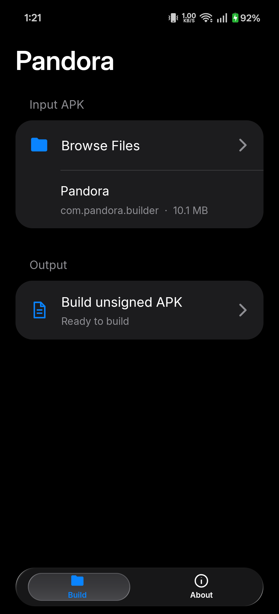
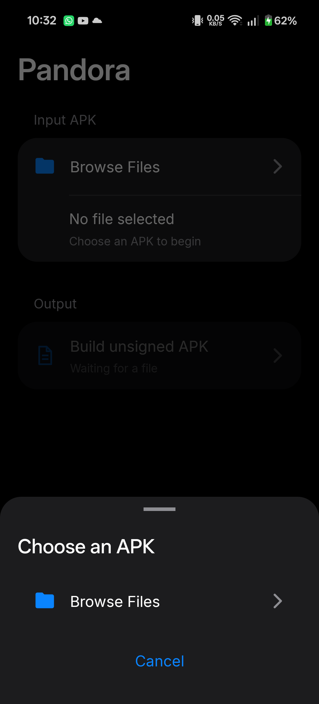
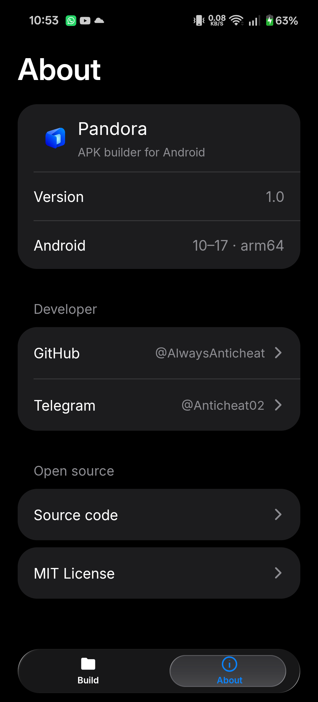

<p align="center"></p>

# Pandora

Pandora is an Android APK builder for arm64 devices running Android 10 through
17. It takes an APK, adds the Pandora payload, and exports an unsigned APK
to a location chosen by the user.

The Android interface uses a dark, grouped layout with a compact animated glass
tab bar. It provides recent file choices, a document picker, build status, and
an About tab with developer links.

## Screenshots

| Build | File selection | About |
| --- | --- | --- |
|  |  |  |

These screenshots were captured from the app on an Android 16 arm64 device.

## Project layout

| Module | Purpose |
| --- | --- |
| `pandora/` | Installable Android builder, file UI, APK transformation, release signing |
| `pandora-core/` | Java bootstrap, C++23 core, JNI bridge, unsigned payload APK |

The builder embeds the unsigned `pandora-core` APK as a generated asset. The
payload supplies DEX files and `libpandora-core.so` when the user builds an
output APK.

## Build

Install Android SDK API 37, NDK 30.0.16248370, JDK 17, and a Gradle-compatible
Android build environment. Set the SDK path in `local.properties` or through
the standard Android SDK environment variable.

```sh
./gradlew :pandora:assembleRelease
```

The installable builder is written to
`pandora/build/outputs/apk/release/pandora-release.apk`. Its release signing
settings are read from the local, ignored
`signing/main-keystore.properties`. The output APK created by the builder is
unsigned.

The local signing properties use these keys:

```properties
storeFile=signing/pandora-main.jks
storePassword=<local password>
keyAlias=pandora_main
keyPassword=<local password>
```

The JKS and properties files stay outside Git. The repository includes the
script `tools/CreateMainKeystore.ps1` to create a new local signing identity.
Run it before a release build when working from a fresh clone.

```powershell
./tools/CreateMainKeystore.ps1 -Keytool "<jdk>/bin/keytool.exe"
```

## APK handling

Pandora reads the input through Android's document picker. It edits the binary
manifest, appends the payload DEX files, adds the arm64 native library, embeds
the original APK, and removes obsolete ZIP signing metadata. If the input has
an `AppComponentFactory`, the payload records its class name and delegates
component creation to it.

The current builder accepts single APK files. Split APK sets need separate
handling. A modified APK must be signed before it can be installed on Android.
The builder's export remains unsigned as requested. The core redirects APK file
access and delegates an existing component factory. It does not replace the
package signature reported by Android's package manager.

## Verification

`./gradlew :pandora:connectedDebugAndroidTest` runs the on-device archive test.
The transformation passed on the connected Android 16 arm64 device. A temporary
signed test output installed and launched, including an input app with an
AndroidX component factory. Device behavior across Android 10 through 17 still
needs testing. AOSP source checks are recorded in
[AOSP-COMPATIBILITY.md](AOSP-COMPATIBILITY.md).

## Developer and license

Developer [@AlwaysAnticheat](https://github.com/AlwaysAnticheat) can be reached
on Telegram at [@Anticheat02](https://t.me/Anticheat02).

Pandora's source is released under the [MIT License](LICENSE). Dependency and
font notices are in [NOTICE.md](NOTICE.md). The interface was informed by the
presentation style of [Files Lab](https://github.com/AlwaysAnticheat/Files-Lab).
